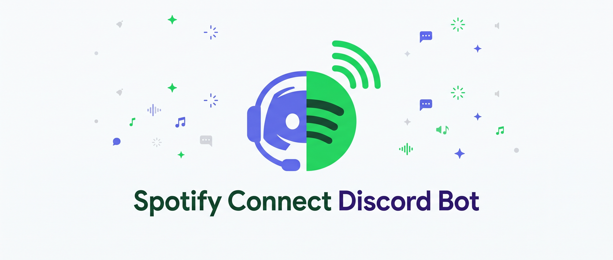
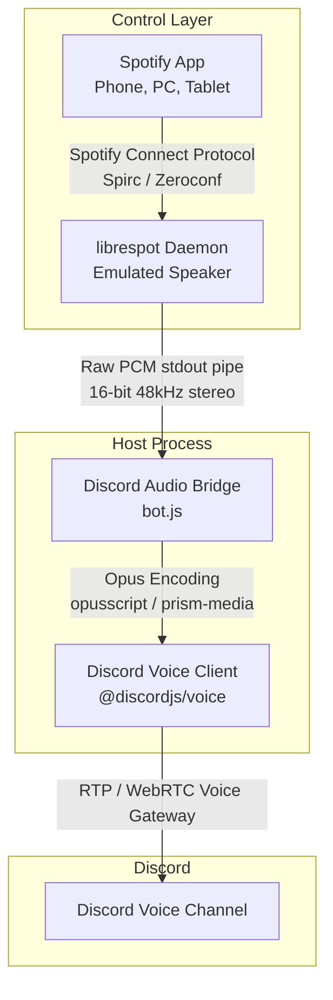

<p align="center">
  
</p>

# 🎵 Spotify Connect Discord Voice Bot

[](https://nodejs.org/)
[](https://discord.js.org/)
[](https://www.npmjs.com/)
[](LICENSE)

A Discord voice bot that turns your Discord voice channel into a native **Spotify Connect** speaker. 

Instead of typing text commands like `!play <url>`, `!skip`, or `/queue`, this bot registers directly as an available speaker in your Spotify app. You can control track playback, scrub time, playlists, and volume straight from Spotify on your phone, desktop, or web client.

---

## ✨ Features

* **Native Spotify Controls:** Play, pause, skip, scrub tracks, and manage your queue directly inside the official Spotify app.
* **No Bot Chat Spam:** Zero chat commands or prefixed slash commands needed in text channels.
* **Direct PCM Audio Streaming:** Uses `librespot` to decode the Spotify stream into raw PCM audio and streams it into Discord via `@discordjs/voice`.
* **Zero Vulnerabilities & Pure JS Encoding:** Powered by `opusscript` and `@yao-pkg/pkg` — no native C++ compiler (Visual Studio / node-gyp) required.
* **Discord DAVE Protocol Ready:** Fully supports Discord's End-to-End Encrypted (DAVE) voice gateway.
* **Standalone Executable:** Can be packaged into a single double-clickable `.exe` (`run-bot.exe`) for non-technical users.

---

## 🏛️ System Architecture



---

## 📋 Prerequisites

| Requirement | Details | Why it's needed |
| :--- | :--- | :--- |
| **Spotify Account** | **Spotify Premium** | Mandatory by Spotify to register a Spotify Connect (Spirc) endpoint. |
| **Discord Bot** | Bot Token & Application | Required to connect to Discord and stream audio to voice channels. |
| **Discord Permissions** | `Connect`, `Speak`, `Use Voice Activity` | Essential voice channel permissions for the bot role. |
| **Operating System** | Windows, macOS, or Linux | Supported natively via Node.js or pre-compiled binaries. |

---

## 🚀 Quick Start (For End-Users)

If you are running the pre-compiled version and do not wish to build from source:

1. **Download the latest release:**
   Go to the [Releases](../../releases) page and download the `spotify-connect-discord-bot-windows-x64.zip`.
2. **Extract the ZIP:**
   Ensure all files remain in the same directory:
   ```
   ├── run-bot.exe
   ├── librespot.exe
   └── .env.example
   ```
3. **Configure your `.env`:**
   * Rename `.env.example` to `.env`.
   * Open `.env` in any text editor and fill in your Discord credentials:
     ```ini
     DISCORD_TOKEN=your_bot_token_here
     GUILD_ID=your_server_id_here
     VOICE_CHANNEL_ID=your_voice_channel_id_here
     SPOTIFY_DEVICE_NAME=Discord Bot Speaker
     ```
4. **Launch the bot:**
   Double-click `run-bot.exe`. The console will authenticate with Discord and join your voice channel.
5. **Connect & Play:**
   * Open Spotify on your phone or PC (connected to the same local network).
   * Click the **Devices** (speaker) icon.
   * Select **Discord Bot Speaker** and start playing music!

---

## 🛠️ Developer Setup (Running from Source)

### 1. Clone the repository
```bash
git clone https://github.com/your-username/spotify-connect-discord-bot.git
cd spotify-connect-discord-bot
```

### 2. Install dependencies
```bash
npm install
```
*(All dependencies resolve cleanly with **0 vulnerabilities**.)*

### 3. Place `librespot` in the project root
Download or compile the `librespot` binary for your operating system and place it directly in the project root:
* **Windows:** `librespot.exe`
* **Linux / macOS:** `librespot`

### 4. Create your `.env` configuration
Copy the template and edit it:
```bash
cp .env.example .env
```
Fill in your configuration:
```ini
# Discord Application Configuration
DISCORD_TOKEN=your_bot_token_here
GUILD_ID=your_server_id_here
VOICE_CHANNEL_ID=your_voice_channel_id_here

# Spotify Connect Configuration
SPOTIFY_DEVICE_NAME=Discord Bot Speaker

# Optional: Spotify Credentials (only required if connecting across subnets / VPS)
SPOTIFY_USERNAME=
SPOTIFY_PASSWORD=
```

### 5. Run the bot
```bash
npm start
```

---

## 📦 Building the Standalone Executable

To compile the application into a single standalone `.exe` that non-coders can launch with a double-click:

```bash
# Windows
npm run build:win

# Linux
npm run build:linux
```

This uses `@yao-pkg/pkg` to generate `run-bot.exe` (or `run-bot` for Linux). The binary bundles the Node runtime and all JavaScript dependencies into one file.

> **Note:** Ensure `run-bot.exe`, `librespot.exe`, and `.env` are kept in the same folder when distributing.

---

## ⚙️ Environment Variables Reference

| Variable | Required | Description |
| :--- | :---: | :--- |
| `DISCORD_TOKEN` | **Yes** | Your Discord Bot Token obtained from the [Discord Developer Portal](https://discord.com/developers/applications). |
| `GUILD_ID` | **Yes** | The Discord Server (Guild) ID where the voice channel resides. |
| `VOICE_CHANNEL_ID` | **Yes** | The Voice Channel ID the bot should join. |
| `SPOTIFY_DEVICE_NAME` | No | Custom name that appears in your Spotify device list (Default: `Discord Bot Speaker`). |
| `SPOTIFY_USERNAME` | No | Your Spotify username/email. Only required if discovery across subnets, VPNs, or cloud servers fails. |
| `SPOTIFY_PASSWORD` | No | Your Spotify password. Only required if `SPOTIFY_USERNAME` is provided. |

---

## 🔍 Troubleshooting & FAQ

#### 1. "Discord Bot Speaker" does not appear in Spotify Devices
* **Cause:** By default, Spotify Connect uses mDNS/Zeroconf local network discovery. If the bot is on a different Wi-Fi band (2.4GHz vs 5GHz), a VPN, or a different subnet, mDNS packets may be blocked.
* **Fix:** Fill in `SPOTIFY_USERNAME` and `SPOTIFY_PASSWORD` in your `.env` file. This forces `librespot` to register with Spotify's cloud access point directly, bypassing local LAN discovery.

#### 2. Bot joins the channel but plays no sound
* Confirm your Spotify account has an active **Spotify Premium** subscription. Free accounts cannot stream through Spotify Connect / `librespot`.
* Verify that the bot role in your Discord server has permissions to **Speak** and **Use Voice Activity**.
* Ensure the volume in your Spotify app is turned up.

#### 3. Error: `librespot.exe was not found`
* Ensure `librespot.exe` is placed in the exact same directory as `bot.js` (or `run-bot.exe`).

#### 4. Audio stutters or buffers
* Check CPU and internet bandwidth. In [`bot.js`](bot.js), you can change `--bitrate 320` to `--bitrate 160` to reduce bandwidth requirements.

---

## 📄 License

This project is licensed under the [ISC License](LICENSE). Note that `librespot` is an independent open-source project licensed under the [GPLv3 License](https://github.com/librespot-org/librespot/blob/dev/LICENSE).

---

## 🤝 Contributing

Contributions, issues, and feature requests are welcome! Feel free to check the [issues page](../../issues).
