<p align="center">
  
</p>

# 🎵 Spotify Connect Discord Voice Bot

[](https://nodejs.org/)
[](https://discord.js.org/)
[](https://www.npmjs.com/)
[](LICENSE)

A Discord voice bot that turns your Discord voice channel into a native, wireless **Spotify Connect** speaker.

Instead of typing text commands like `!play <url>`, `!skip`, or `/queue`, control track playback, scrub time, playlists, and volume straight from the official Spotify app on your phone, tablet, or PC.

---

## ✨ Why This Approach?

Recent Spotify updates broke reverse-engineered third-party clients (like `librespot`), causing frequent `AudioKeyError` track-skipping bugs due to server-side DRM restrictions.

This bot uses an official **Spotify Desktop + Virtual Audio Loopback (VB-CABLE)** architecture:
* **🛡️ 100% DRM-Proof:** Uses the official Spotify client with genuine Widevine/PlayReady DRM licenses. Zero track skipping, zero audio key errors.
* **📱 Wireless Phone Control:** Use native Spotify Connect on your mobile device (iOS / Android) to cast, queue, and control playback on your desktop host.
* **🎧 Full Sound Isolation:** Spotify routes silently into the virtual cable. Your games, Discord voice chats, and personal PC audio stay in your headphones and are never broadcast.
* **⚡ Studio Quality Audio:** Captures pure 48kHz 16-bit stereo PCM audio with zero latency overhead.
* **🔒 Zero Vulnerabilities & Pure JS Encoding:** Powered by `opusscript` and `@yao-pkg/pkg` — no native C++ compiler (Visual Studio / node-gyp) required.
* **🚀 Discord DAVE Protocol Ready:** Fully compliant with Discord's End-to-End Encrypted (DAVE) voice gateway.

---

## 🏛️ System Architecture

```mermaid
flowchart LR
    subgraph Mobile [Remote Control]
        Phone["📱 Spotify Mobile App<br/>(iOS / Android)"]
    end

    subgraph HostPC [Windows Host Machine]
        Phone -- "Spotify Connect (Native)" --> SpotifyApp["🎵 Official Spotify Desktop App<br/>(Official DRM - Zero Skipping)"]
        SpotifyApp -- "Windows Volume Mixer<br/>Output Routing" --> VBCableIn["🎛️ CABLE Input<br/>(VB-Audio Virtual Cable)"]
        VBCableIn -. "Internal Audio Driver" .-> VBCableOut["🎙️ CABLE Output<br/>(DirectShow Recording Endpoint)"]
        
        subgraph BotSystem [Discord Voice Bot Process]
            FFmpeg["⚡ ffmpeg.exe<br/>(dshow capture, S16LE 48kHz Stereo)"]
            VBCableOut --> FFmpeg
            FFmpeg -- "Raw PCM stdout" --> NodeStream["bot.js Audio Pipeline"]
            NodeStream --> AudioResource["createAudioResource(Raw)"]
            AudioResource --> DiscordVoice["@discordjs/voice Player"]
        end
    end

    subgraph DiscordCloud [Discord Server]
        DiscordVoice -- "Opus UDP Stream (DAVE Protocol)" --> VoiceChannel["🔊 Voice Channel"]
    end
```



---

## 🖥️ Platform Compatibility

| Operating System | Status | Audio Pipeline | Distribution |
| :--- | :---: | :--- | :--- |
| **Windows (10 / 11)** | ✅ **Supported** | VB-Audio Virtual Cable (DirectShow) | Standalone `run-bot.exe` pre-packaged ZIP |
| **Linux (Ubuntu / Debian / Arch)** | 📋 **Planned** | PulseAudio / PipeWire Virtual Null Sink | Source execution (`npm start`) |
| **macOS (Intel / Apple Silicon)** | 📋 **Planned** | [BlackHole](https://github.com/ExistentialAudio/BlackHole) Virtual Driver (AVFoundation) | Source execution (`npm start`) |

> 💡 **Community Feedback:** If you would like to help test or contribute native setups for Linux or macOS, please join the discussion on our [Tracking Issue](../../issues).

---

## 📋 Prerequisites

| Requirement | Details | Why it's needed |
| :--- | :--- | :--- |
| **Spotify Account** | Free or Premium | Official Spotify Desktop plays for all account tiers. |
| **Spotify Desktop App** | Installed on Host PC | Acts as the official playback engine and Spotify Connect target. |
| **VB-Audio Virtual Cable** | Free Windows driver ([Download](https://vb-audio.com/Cable/)) | Routes Spotify's audio into the bot without mixing your PC sounds. |
| **Discord Bot** | Bot Token & Application | Required to connect to Discord and stream audio to your voice channel. |
| **Discord Permissions** | `Connect`, `Speak`, `Use Voice Activity` | Essential voice channel permissions for the bot. |

---

## 🚀 Quick Start (For End-Users)

If you are running the pre-compiled version and do not wish to build from source:

### 1. Install VB-Audio Virtual Cable (Free)
1. Download VB-CABLE from [vb-audio.com/Cable/](https://vb-audio.com/Cable/).
2. Extract the ZIP archive, right-click **`VBCABLE_Setup_x64.exe`**, and select **"Run as administrator"**.
3. Click **Install Driver**.

### 2. Download the Bot Package
1. Go to the [Releases](../../releases) page and download `spotify-connect-discord-bot-windows-x64.zip`.
2. Extract the ZIP archive. Keep all files in the same folder:
   ```
   ├── run-bot.exe
   ├── ffmpeg.exe
   ├── .env.example
   ├── README.md
   └── LICENSE
   ```

### 3. Route Spotify Desktop to the Virtual Cable
1. Open the **Spotify Desktop app** and start playing any song.
2. Open Windows **Settings** $\rightarrow$ **System** $\rightarrow$ **Sound** $\rightarrow$ **Volume mixer** *(or search "Volume mixer" in Windows)*.
3. Locate **Spotify** under the Apps section:
   * Change its **Output device** from *Default* to:
     👉 **`CABLE Input (VB-Audio Virtual Cable)`**

*(Spotify will now play silently into the virtual cable. Your headphones remain free for your games, music, or Discord calls!)*

### 4. Configure your `.env`
1. Copy `.env.example` and rename it to `.env`.
2. Open `.env` in any text editor and fill in your Discord credentials:
   ```ini
   DISCORD_TOKEN=your_bot_token_here
   GUILD_ID=your_server_id_here
   VOICE_CHANNEL_ID=your_voice_channel_id_here
   AUDIO_DEVICE_NAME=CABLE Output (VB-Audio Virtual Cable)
   ```

### 5. Launch and Enjoy!
Double-click **`run-bot.exe`**.
* The bot will join your designated voice channel.
* Open Spotify on your phone (or PC), select your PC under the **Devices / Connect** menu, and start playing music!

> [!NOTE]
> **Windows Defender / SmartScreen Warning:**  
> On your first launch, Windows SmartScreen may display a popup saying *"Windows protected your PC"*. This is expected for newly compiled open-source executables without expensive corporate code-signing certificates. Click **"More info"** and then **"Run anyway"**.

---

## 🛠️ Developer Setup (Running from Source)

### 1. Clone the repository
```bash
git clone https://github.com/your-username/spotify-connect-discord-bot.git
cd spotify-connect-discord-bot
```

### 2. Install dependencies
```bash
npm install
```
*(All dependencies resolve cleanly with **0 vulnerabilities**.)*

### 3. Verify Audio Devices
To verify your virtual audio cable name or inspect DirectShow devices:
```bash
node bot.js --list-devices
```

### 4. Configure `.env`
```bash
cp .env.example .env
```
Fill in your `DISCORD_TOKEN`, `GUILD_ID`, and `VOICE_CHANNEL_ID`.

### 5. Start the bot
```bash
npm start
```

---

## 📦 Building the Standalone Executable

To compile the application into a single standalone `.exe` that non-coders can launch with a double-click:

```bash
# Windows x64
npm run build:win

# Linux x64
npm run build:linux
```

This uses `@yao-pkg/pkg` to generate `run-bot.exe`.

> **Note:** Ensure `run-bot.exe`, `ffmpeg.exe`, and `.env` are placed in the same folder when distributing.

---

## ⚙️ Environment Variables Reference

| Variable | Required | Description |
| :--- | :---: | :--- |
| `DISCORD_TOKEN` | **Yes** | Your Discord Bot Token from the [Discord Developer Portal](https://discord.com/developers/applications). |
| `GUILD_ID` | **Yes** | The Discord Server (Guild) ID where the voice channel resides. |
| `VOICE_CHANNEL_ID` | **Yes** | The Voice Channel ID the bot should join. |
| `AUDIO_DEVICE_NAME` | No | DirectShow recording device name (Default: `CABLE Output (VB-Audio Virtual Cable)`). |

---

## 🔍 Troubleshooting & FAQ

#### 1. Error: `Could not find audio recording device`
* **Fix:** Make sure VB-CABLE is installed. Run `node bot.js --list-devices` (or `run-bot.exe --list-devices`) to list the exact names of all audio recording devices detected on your system. Copy the exact name into `AUDIO_DEVICE_NAME` in `.env`.

#### 2. The bot is in the voice channel, but no sound is playing
* **Check Spotify Volume Mixer:** Ensure Spotify's output is set specifically to **`CABLE Input (VB-Audio Virtual Cable)`** in Windows Volume Mixer, and that Spotify is actually playing.
* **Check Discord Permissions:** Verify that the bot role in your Discord server has permissions to **Speak** and **Use Voice Activity**.
* **Check Spotify Volume:** Make sure the volume slider inside Spotify is turned up.

#### 3. Can I control playback from my phone?
* **Yes!** As long as the Spotify Desktop app is running on your PC, open Spotify on your phone (connected to the same account or local Wi-Fi), tap the **Connect Devices** icon, and choose your computer. You can now use your phone as a full remote control.

#### 4. Windows SmartScreen or Antivirus blocks `run-bot.exe`
* **Why it happens:** Windows SmartScreen flags newly downloaded executables that lack expensive commercial EV code-signing certificates.
* **How to run:** When the blue popup appears, click **"More info"** $\rightarrow$ **"Run anyway"**. Alternatively, right-click `run-bot.exe` $\rightarrow$ select **Properties** $\rightarrow$ check **"Unblock"** at the bottom $\rightarrow$ click **Apply**.

---

## 📄 License

This project is licensed under the [ISC License](LICENSE).

---

## 🤝 Contributing

Contributions, issues, and feature requests are welcome! Feel free to check the [issues page](../../issues).
